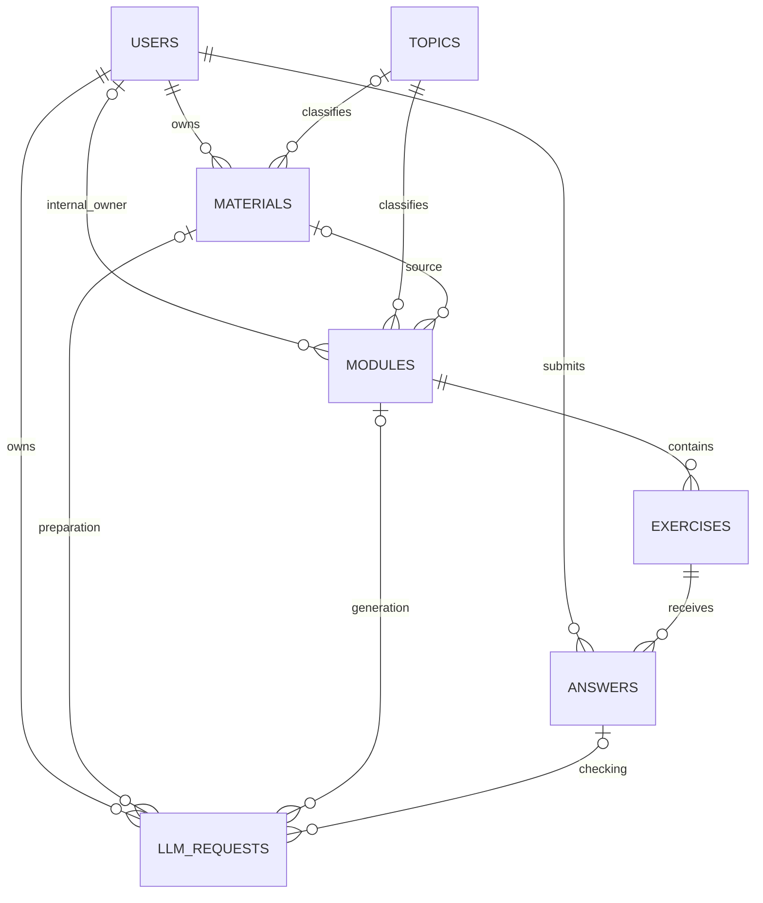

# Общая база данных LingoWay

Версия 0.2 от 15 октября 2026 года. Схема объединяет пользователей, материалы, модули и задания. Для работы с LLM используется одна служебная таблица. Сущности представлены моделями GORM в бэкенде; бизнес-ручки из OpenAPI пока не реализованы.

- [SQL общей БД](schema.sql).
- [Схема в PNG](be3/images/be3-database.png) и [поток API в PNG](be3/images/be3-api-flow.png).
- [Шаблоны JSON Schema](exercise-templates.json), [девять примеров с ключами и ответами](exercise-examples.json).
- [OpenAPI v0.2](be3/openapi.json).

## 1. Семь таблиц

| Таблица | Что хранит |
|---|---|
| `users` | Учётная запись: email, хэш пароля, имя, роль, дата создания |
| `topics` | Темы: IT, авиация, музыка и другие |
| `materials` | Исходный материал, автор, тема, текст или ссылка на файл в S3, извлечённый текст и CEFR |
| `modules` | Название, тема, сложность A1–C2, источник, доступ и состояние; необязательный внутренний создатель |
| `exercises` | Задания модуля: тип, инструкция, вопрос, публичное содержимое, приватный ключ и объяснение |
| `answers` | Отдельные ответы пользователей и результаты их проверки |
| `llm_requests` | Подготовка материала, генерация модуля и проверка открытого ответа: параметры, статус, результат, ошибка |

Все сущности имеют положительный числовой ID `bigint`. Это соответствует числовым ID из шаблонов и упрощает работу с Go/GORM. UUID используется только для ключа повторного запроса и аренды фоновой работы.

У `users` сейчас нет уровня, прогресса, словаря, достижений или стрика. Роли — `student`, `teacher`, `admin`. Пароль хранится только как `password_hash`; в API это поле не возвращается. Email уникален без учёта регистра.

`answers` — исходные записи ответов для функции проверки, а не таблица накопленного прогресса. Повторный ответ создаёт новую строку. Агрегаты, прохождение модуля, личный словарь и статистика будут добавлены отдельно.



У каждого запроса LLM ровно один целевой ресурс: материал **или** модуль **или** ответ. Для опубликованного модуля обязательны минимум два задания; в черновике может быть ноль или одно.

## 2. Модуль и задания

Модуль непосредственно содержит несколько заданий через `exercises.module_id`. Дополнительных наборов заданий, уроков и попыток прохождения в этой версии нет.

Основные поля модуля:

| Поле | Пример | Назначение |
|---|---|---|
| `title` | Algorithms and code | Название |
| `topic_id` | 1 → IT | Тема из `topics` |
| `difficulty` | B1 | Сложность CEFR A1–C2 |
| `created_by_user_id` | 1 или NULL | Внутренний владелец для доступа; в публичном API отсутствует |
| `material_id` | 1 или NULL | Материал-источник; NULL для ручного модуля |
| `visibility` | private | Свой материал остаётся приватным |
| `status` | draft / generating / ready / failed | Состояние |

Задания наследуют тему и сложность от модуля. Поэтому из общих полей исходных шаблонов `lesson_id` заменён на `module_id`, а `topic` и `level` получаются соединением с модулем. API по-прежнему выдаёт заданию `level` и `topic_id`; отдельных дублирующих колонок в `exercises` нет.

Остальные поля из шаблонов представлены напрямую: `id`, `type`, `instruction`, `question_text`, `explanation`. Правильный ответ хранится в `answer_key` как JSON: это позволяет одинаково описывать вариант ответа, пары, последовательность и рубрику для открытого вопроса.

Состояния модуля:

```text
Ручное создание: draft → ready
Генерация:      generating → ready / failed
Повтор LLM:    failed → generating → ready / failed
```

Публикация делает содержимое неизменяемым. Для исправления создаётся новый модуль; прежние ответы продолжают относиться к прежним заданиям. Нельзя удалить одно задание опубликованного модуля и нарушить его состав. Явное удаление всего модуля удаляет его задания, ответы и связанные LLM-запросы.

У модуля нет обязательного публичного автора. `created_by_user_id` — служебная связь для контроля доступа, которая не входит в публичный `Module`. Системный публичный модуль, созданный внутри административного сервиса или начальным наполнением, может иметь `created_by_user_id = NULL` и не иметь материала-источника. Управлять таким модулем может только администратор; отсутствие создателя само по себе не даёт прав на изменение.

При создании модуля через пользовательский API сервер сохраняет пользователя из JWT как внутреннего владельца. Для публичного модуля с указанным создателем требуется роль `teacher` или `admin`. Приватный модуль обязан иметь владельца. Модуль из личного материала всегда `private`, и его владелец должен совпадать с владельцем материала; удаление связи с владельцем не позволяет обойти приватность. Это проверяют именованные CHECK-ограничения, составной FK и триггер. Отсутствие автора у системного модуля не мешает ученикам отправлять ответы на его опубликованные задания.

## 3. Девять типов по документу шаблонов

Источник — предоставленный документ «Шаблоны заданий.docx». Его описания использованы как требования к формату упражнений. Перечень дополнительных сущностей в конце документа не расширяет текущую задачу: программы обучения и уроки сейчас не добавляются.

| `type` | Тип задания | `content.format` | Что проверяем |
|---|---|---|---|
| `vocabulary_gap` | Пропуск слова | single_choice | Один правильный вариант из четырёх |
| `vocabulary_matching_translation` | Слово — перевод | matching | 4–6 пар, переводы перемешаны |
| `vocabulary_matching_definition` | Слово — определение | matching | 4–6 пар, определения на английском |
| `vocabulary_context_choice` | Выбор по контексту | single_choice | Один правильный вариант из четырёх |
| `grammar_brackets` | Раскрытие скобок | single_choice | Правильная форма из четырёх вариантов |
| `grammar_tense` | Выбор времени | single_choice | Четыре временные формы одного глагола |
| `grammar_word_order` | Порядок слов / перевод | word_order | Последовательность ID слов; лишние слова разрешены |
| `comprehension_question` | Вопрос на понимание | free_text | Ответ по контексту и рубрике |
| `reasoning_question` | Открытый вопрос / разговорная практика | free_text | Обоснование по рубрике, возможны пять слов для закрепления |

Сопоставление перевода и определения теперь имеет разные типы. Старый `grammar_form` не используется отдельно: документ описывает выбор времени и раскрытие скобок. В отличие от прототипа v0.1, пропуск слова, время и скобки имеют четыре варианта ответа. В порядке слов нельзя требовать использования всех токенов: шаблон содержит дистракторы `apple`, `airport`.

Общие методические проверки EXP выполняются сервисом: слово/конструкция соответствует теме и CEFR, дистракторы подходят по части речи и уровню, у временных заданий есть указатель времени, определение не содержит самого слова и проще его. JSON-схема проверяет форму, но не подтверждает методическое качество текста.

## 4. Как выглядит одно задание

`content` содержит данные для отображения. `answer_key` и `explanation` остаются на сервере. Отдельные таблицы для вариантов, пар, слов и приватных ключей не нужны на этом этапе.

```json
{
  "type": "vocabulary_gap",
  "instruction": "Выберите правильный вариант.",
  "question_text": "The ___ is a set of steps to solve a problem.",
  "content": {
    "format": "single_choice",
    "options": [
      {"id": "c1", "text": "algorithm"},
      {"id": "c2", "text": "apple"},
      {"id": "c3", "text": "airport"},
      {"id": "c4", "text": "animal"}
    ]
  },
  "answer_key": {"correct_choice_id": "c1"},
  "explanation": "Algorithm — последовательность шагов для решения задачи."
}
```

Публичный DTO исключает `answer_key` и `explanation`. После проверки сервер возвращает отдельный `Answer` с `score`, `is_correct` и `feedback`, в который можно включить объяснение. Нельзя сериализовать всю GORM-модель задания напрямую. Тип дистрактора при необходимости хранится в приватном `answer_key.distractor_types`, чтобы не раскрыть верный вариант.

Формы ответа:

```json
{"format":"single_choice","choice_id":"c1"}
{"format":"matching","pairs":[{"left_id":"w1","right_id":"r2"}]}
{"format":"word_order","token_ids":["t2","t9","t4","t6","t8","t5","t1"]}
{"format":"free_text","text":"It is a set of steps to solve a problem."}
```

Фрагмент matching выше показывает структуру одной пары; реальный ответ содержит все 4–6 пар. Полные валидные примеры всех девяти типов находятся в `exercise-examples.json`.

Сервис проверяет, что ID вариантов/слов существуют, не повторяются и не кодируют правильное соответствие. Для matching все левые и правые элементы используются ровно один раз. В word_order ответ может использовать подмножество слов, но каждый выбранный токен — не более одного раза. Перемешивание и ID фиксируются при публикации.

## 5. Упрощённая работа с LLM

Теперь для интеграции достаточно одной таблицы `llm_requests` и одного общего формата результата генерации.

| `operation` | Целевой FK | Что делает воркер |
|---|---|---|
| `prepare_material` | `material_id` | Извлечение текста / STT, определение CEFR |
| `generate_module` | `module_id` | Генерация и валидация всех заданий модуля |
| `check_answer` | `answer_id` | Проверка одного открытого ответа по рубрике |

Три FK необязательны по отдельности, но CHECK требует ровно один в соответствии с операцией. Составные FK также гарантируют владельца целевого ресурса. `parameters` хранит выбранные типы, количество и параметры операции. Источник читается по FK; копии материала, фрагментов и полного промпта в нескольких таблицах не создаются.

Промпты и ожидаемая JSON-схема — версионируемые файлы приложения. `prompt_version` фиксирует использованную версию; `provider` и `model` — конкретный вызов. Отдельного кэша в MVP нет. При необходимости его можно добавить после измерения повторных запросов и стоимости.

Минимальный ответ LLM при генерации:

```json
{
  "exercises": [
    {"type":"...", "instruction":"...", "question_text":"...",
     "content":{}, "answer_key":{}, "explanation":"..."}
  ]
}
```

Это сокращённая иллюстрация структуры, не валидный пример упражнения. Реальные элементы должны пройти `exercise-templates.json`. Модель не назначает IDs, владельца, тему или сложность — их задаёт сервер по модулю.

Воркер получает модуль → материал → текст, формирует запрос, валидирует ответ, затем одной транзакцией вставляет все задания, переводит модуль в `ready` и запрос в `succeeded`. До успешной валидации задания не выдаются ученику. Для N заданий и k уникальных типов требуется `N >= k`; каждому типу выдаётся `floor(N/k)`, остаток — первым типам в порядке запроса. Для генерации модулей N от 2 до 30; ручные модули не ограничены 30 заданиями.

Длинный текст разбивается и выбирается в памяти воркера; постоянной таблицы chunks пока нет. Итоговый текст ограничен 200 000 символов. Перед вызовом учитывается токенный лимит модели: нельзя молча отправить только начало текста или потерять существенные фрагменты. Упражнение на понимание содержит необходимый `content.context`, чтобы ученик видел основание вопроса.

Очередь использует `queued/running/succeeded/failed`. Для MVP её можно читать из той же таблицы через `FOR UPDATE SKIP LOCKED`. `lease_token` и `lease_expires_at` нужны только для восстановления после падения воркера; старый воркер не может записать результат после смены аренды. Повторы ограничены конфигурацией, с задержкой для timeout/429/5xx. Ключи провайдера остаются в окружении.

Успешный `result` хранит ссылки/краткий итог, например `{"module_id":1,"exercise_count":9}`. API отдаёт только статус, безопасную ошибку и целевые ID. Промпты, ключи ответов, raw JSON провайдера и внутренние рассуждения в публичный ответ не попадают.

## 6. Проверка ответов без отдельного прогресса

Закрытые задания проверяются кодом по `answer_key`. Открытые — через `check_answer`. Одна строка `answers` содержит вход и итог, отдельные `attempts`, `attempt_answers` и `evaluations` больше не используются.

```text
Закрытый ответ: POST → answers.checked → 201 с оценкой и объяснением
Открытый ответ: POST → answers.pending + llm_requests.queued → 202
               GET llm-requests → succeeded → GET answers → checked
```

`response` после отправки неизменяем. Исправление ответа создаёт новую запись. Пока ответ pending/failed, `score`, `is_correct`, `feedback` равны NULL. `is_correct` вычисляется БД из полного балла `score = 1`; частичный балл допускается, правила EXP задаются рубрикой. В MVP нет веса упражнения, итоговой оценки модуля или события обновления прогресса.

Каждый ключ `Idempotency-Key` — UUID. Для материала область `(owner_user_id, request_key)`, для ответа `(user_id, request_key)`, для LLM `(owner_user_id, operation, request_key)`. Ключи не истекают. При повторе сервер сначала проверяет исходный ввод/параметры и доступ, затем возвращает существующую запись; другой вход с тем же ключом — `409 IDEMPOTENCY_CONFLICT`. Отдельная таблица ключей не требуется. Обычное ручное создание/редактирование черновика ключа не требует.

Повтор failed-запроса разрешён только для временной ошибки. Создаётся новая строка `llm_requests` с новым ключом, тем же целевым ресурсом и параметрами. Один частичный уникальный индекс на каждый вид FK запрещает две активные задачи на один ресурс. При повторе генерации черновики исходного failed-модуля заменяются атомарно; уже ready-модуль не меняется.

## 7. Файлы и доступ

S3-совместимое хранилище, включая выбранную командой поставку MinIO, хранит оригинальные документы/аудио. В `materials.object_key` — приватный ключ объекта; имя бакета берётся из конфигурации `S3_BUCKET`. Временные подписанные URL не записываются в БД. Текст из формы хранится в `source_text`, подготовленный текст — в `extracted_text`.

Документы — до 20 MiB (TXT/PDF/DOCX), аудио — до 50 MiB (MP3/WAV/M4A/OGG). Аудио остаётся целевой возможностью; при выключенном флаге API возвращает `FEATURE_DISABLED`. Валидация файла проверяет поток, сигнатуру, размер и лимит распаковки DOCX. Ссылки скачиваются только с публичных HTTP(S)-адресов с проверкой каждого редиректа, размера и времени.

JWT определяет пользователя; `owner_user_id`, `created_by_user_id` и `user_id` не принимаются от клиента. `created_by_user_id` также не возвращается в публичном модуле. Чужой приватный материал/модуль/ответ/запрос возвращает `404`. Для публичного модуля, включая системный без создателя, доступно чтение заданий и отправка своего ответа. Ответы других учеников остаются приватными.

Удаление материала/модуля — явное физическое удаление связанных заданий, исходных ответов и запросов. Проверка отсутствия активной работы и pending-ответов выполняется под блокировками. До удаления строки материала сохраняется задание на удаление S3-объекта; неудачная внешняя операция повторяется. БД не обеспечивает транзакцию с S3. Перед добавлением прогресса или аудита этот порядок удаления нужно пересмотреть.

## 8. Что изменилось по сравнению с прототипом

| Было | Стало |
|---|---|
| Только сущности BE3 и предлагаемые FK к пользователям | Общие реальные `public.users`, `topics`, `modules` и остальные таблицы |
| `exercise_sets` плюс будущие уроки | Один `modules` с названием, темой и сложностью |
| `exercises` + `exercise_keys` | Одна таблица, явное разделение публичных полей и приватного `answer_key` в DTO |
| `attempts` + `attempt_answers` + `evaluations` | Одна таблица `answers` для каждого отправленного ответа |
| `jobs` + `llm_calls` + `llm_cache` + `prompt_templates` | Одна `llm_requests`; промпты в файлах, кэш пока не нужен |
| `material_chunks` | Разбиение текста в памяти воркера |
| `api_idempotency_keys` | Ключи на самих ресурсах/запросах |
| `outbox_events` и учёт прогресса | Отложено вместе с прогрессом и словарём |
| UUID доменных сущностей | Числовые `bigint`, как в шаблонах |

Контракты v0.2 изменяют пути: `exercise-sets` → `modules`, `jobs` → `llm-requests`, попытки прохождения → отдельные ответы. Это изменение проектных контрактов, не совместимая миграция опубликованного API. В репозитории эти обработчики ещё не реализованы.

Дополнительные программы обучения, уроки, словарь и агрегированный прогресс можно добавить позже поверх модулей, не усложняя текущую генерацию.

## 9. Применение и проверки

`docs/schema.sql` — справочный SQL для новой пустой PostgreSQL 16. Старый путь `docs/be3/schema.sql` сохранён как входной файл для psql, который подключает общую схему. Справочный SQL не нужно выполнять поверх таблиц, уже созданных GORM. Если старый прототип `be3.*` уже применён вне этого репозитория, необходима отдельная миграция данных после проверки фактического состояния.

Модели разделены по секциям; общие типы находятся в корневом пакете:

| Пакет | Содержимое |
|---|---|
| [`models`](../backend/internal/models) | Общие перечисления типов и состояний (`enums.go`), тип `JSON` (`json.go`) |
| [`users`](../backend/internal/models/users) | `User`, `UserRole` — пользователь и его роль |
| [`topics`](../backend/internal/models/topics) | `Topic`, `Module`, `Exercise` — темы, модули и задания |
| [`llm`](../backend/internal/models/llm) | `Material`, `Answer`, `LLMRequest` — материалы, ответы и очередь LLM |

Пакет `llm` описывает подготовку материала, проверку ответа и общую очередь запросов. Учебные модули и задания находятся в `topics`. Пакеты используют общие типы из `models`, а связи с пользователем — модель из `users`. Все три операции LLM по-прежнему используют одну очередь `llm_requests`. Разделение по папкам не меняет SQL-схему и API-контракты.

Штатный запуск использует эти модели и пакет [`backend/internal/database`](../backend/internal/database). `database.Open(ctx, cfg)` открывает подключение GORM и проверяет доступность PostgreSQL. `database.Migrate(ctx, db)` обновляет схему одной транзакцией под advisory lock. Это защищает от одновременного изменения схемы несколькими экземплярами приложения. Кроме таблиц GORM миграция устанавливает индексы, составные FK и защитные триггеры. Она также разрешает NULL в `modules.created_by_user_id` для ранее созданной общей схемы, сохраняя ограничения приватности. Бизнес-обработчики из OpenAPI в эту задачу не входят.

`DATABASE_URL` обязателен; `DB_AUTO_MIGRATE=true` включает обновление при запуске, `false` отключает. По умолчанию пул содержит максимум 10 открытых и 5 свободных подключений (`DB_MAX_OPEN_CONNS`, `DB_MAX_IDLE_CONNS`), срок подключения — `30m` (`DB_CONN_MAX_LIFETIME`). Подключение ограничено `5s` (`DB_CONNECT_TIMEOUT`), миграция — `1m` (`DB_MIGRATION_TIMEOUT`). Неверные значения конфигурации, ошибка подключения или миграции останавливают запуск сервера; пул закрывается при завершении.

После изменения полей модели включённая автомиграция применяет дополнения к схеме. Переименование и удаление колонок, разрушающее изменение типов и заполнение старых строк требуют отдельной проверенной SQL-миграции. Новый ресурс нужно включить в общий список моделей миграции. Перед обновлением окружения с данными следует проверить миграцию на отдельной копии. Параметры запуска приведены также в [README](../README.md).

Проверки SQL должны включать общие FK, уникальность email/позиции, приватность материала, публикацию минимум двух заданий, неизменяемость опубликованного задания/ответа, допустимость балла и единственную активную LLM-работу. Проверки JSON включают все девять типов, четыре варианта выбора, 4–6 пар и правильное использование подмножества слов с дистракторами. Методическое качество утверждает EXP.

Проверки относятся к конкретному запуску и не заменяют проверку миграций после изменения моделей. Для текущей схемы дополнительно проверяются системный публичный модуль без создателя, отказ приватному модулю без владельца, принадлежность исходного материала и скрытие внутреннего владельца в публичном API. HTTP/LLM-тесты понадобятся при реализации соответствующих обработчиков.
